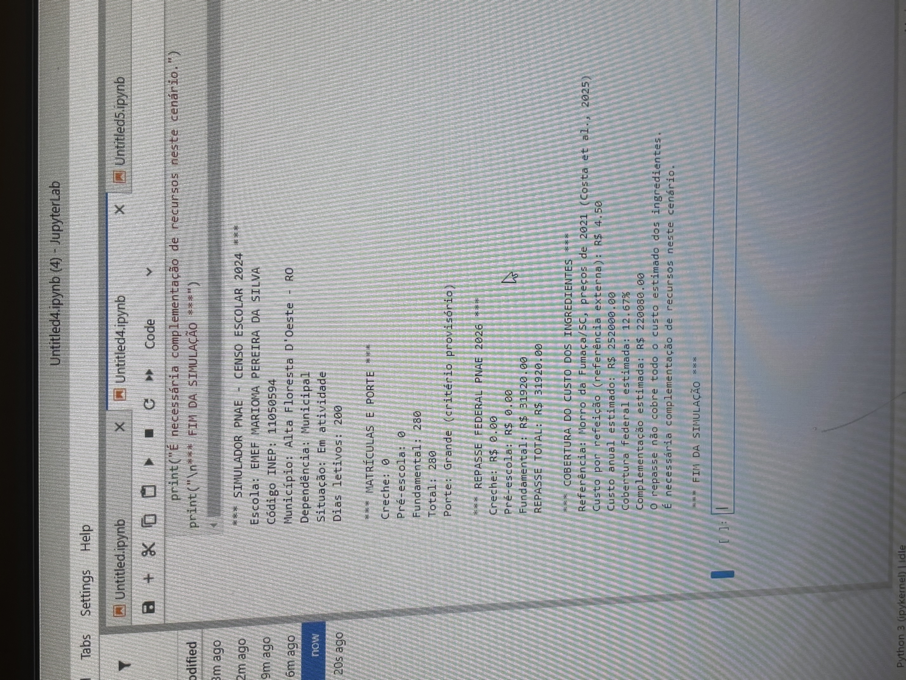

# Projeto 3 — Simulador de Repasse do PNAE em Python

## Objetivo

Neste projeto, nosso grupo desenvolveu um simulador em Python para calcular quanto uma escola pública recebe de recursos federais do Programa Nacional de Alimentação Escolar (PNAE). Além do repasse, o programa estima quanto desse valor seria suficiente para pagar os ingredientes de uma refeição escolar. A ideia foi continuar o simulador que fizemos no Excel, no Projeto 1, agora utilizando funções em Python e dados de uma escola real.

## Como usar

Para executar o simulador, é preciso ter o Python 3 instalado. Depois, basta baixar o arquivo `simulador_pnae.py`, abrir o terminal na pasta onde ele está salvo e digitar:

```bash
python simulador_pnae.py
```

O programa pode ser usado de três maneiras:

- **Escola real do Projeto 3:** `python simulador_pnae.py`. Usa os dados do Censo 2024 e reproduz o resultado mostrado no print abaixo.
- **Teste do Projeto 1:** `python simulador_pnae.py --teste`. Usa 60 matrículas de creche, 80 de pré-escola e 50 do fundamental, em 200 dias letivos. O resultado esperado é **R$ 37.660,00**, com porte **Pequena**. A EMEB Vila Quitaúna é apenas a identificação do exemplo didático, não uma escola validada na base do Censo.
- **Preenchimento pelo usuário:** `python simulador_pnae.py --interativo`. O programa pergunta o nome da escola, o código INEP, município, UF, dependência, situação, dias letivos e matrículas nas três etapas. Os campos de matrículas e dias letivos devem receber **números inteiros não negativos**. Se a escola não oferecer uma etapa, digite **0**.

Em qualquer modo, o programa apresenta o repasse federal, o custo estimado dos ingredientes, a porcentagem coberta e a complementação necessária no cenário simulado. O custo de referência permanece fixado em R$ 4,50 no início do código.

## Escola escolhida

Escolhemos a **EMEF Marioma Pereira da Silva**, uma escola municipal de **Alta Floresta D'Oeste (RO)**. Ela aparece como **em atividade** no Censo Escolar 2024 e tem o código INEP **11050594**.

| Etapa de ensino | Matrículas |
|---|---:|
| Creche | 0 |
| Pré-escola | 0 |
| Ensino fundamental | 280 |
| **Total considerado** | **280** |

Para encontrar os dados, consultamos o arquivo `Censo_2024_Excel.xlsx`, na aba `Microdados`, e localizamos a escola pelo campo `CO_ENTIDADE`, usando o código 11050594. Conferimos também o nome, o município, a UF, a dependência administrativa, a situação de funcionamento e as matrículas. Como a escola não tem matrículas na educação infantil, colocamos zero nos campos de creche e pré-escola.

## Custo dos alimentos

O repasse federal e o custo de uma refeição são coisas diferentes. Para 2026, usamos no programa os seguintes valores de repasse por aluno/dia:

| Etapa | Valor federal |
|---|---:|
| Creche | R$ 1,57 |
| Pré-escola | R$ 0,82 |
| Ensino fundamental | R$ 0,57 |

Fonte: [FNDE — Programa Nacional de Alimentação Escolar](https://www.gov.br/fnde/pt-br/acesso-a-informacao/acoes-e-programas/programas/pnae), Resolução CD/FNDE nº 1/2026.

Para estimar o custo dos **ingredientes**, adotamos **R$ 4,50 por refeição**. Encontramos esse valor em um [artigo publicado em 2025 na revista *Cadernos de Saúde Pública*](https://pmc.ncbi.nlm.nih.gov/articles/PMC12448751/). A Tabela 1 do estudo apresenta esse valor como a mediana do custo das refeições analisadas em escolas municipais de **Morro da Fumaça (SC)**, com preços de **2021**.

Escolhemos esse estudo porque ele calcula o custo direto dos alimentos usados nas preparações, e é justamente esse valor que a professora pede para comparar com o repasse federal. Não estamos incluindo gastos com funcionários, gás ou manutenção da cozinha.

**Essa é uma referência para a simulação, não o custo real da escola de Rondônia.** O estudo foi feito em outro município e em outro ano. Por isso, diferenças de preços, cardápio e tamanho das porções podem alterar bastante os resultados.

## Resultados e reflexão

Consideramos **200 dias letivos** e **uma refeição por aluno por dia**. O repasse é calculado multiplicando as matrículas de cada etapa pelos dias letivos e pelo valor federal correspondente. Para estimar o custo dos alimentos, multiplicamos o número de alunos por 200 dias e por R$ 4,50. Depois, calculamos a porcentagem coberta pelo repasse e a diferença restante.

| Resultado | Valor |
|---|---:|
| Alunos considerados | 280 |
| Repasse anual de creche | R$ 0,00 |
| Repasse anual de pré-escola | R$ 0,00 |
| Repasse anual do fundamental | R$ 31.920,00 |
| **Repasse federal total** | **R$ 31.920,00** |
| **Custo anual estimado dos ingredientes** | **R$ 252.000,00** |
| **Cobertura estimada pelo repasse federal** | **12,67%** |
| **Diferença estimada a complementar** | **R$ 220.080,00** |

Como a escola só tem matrículas no ensino fundamental entre as três etapas analisadas, o repasse considerado é de R$ 0,57 por aluno/dia. Na simulação, esse valor cobriria aproximadamente **12,67%** do custo estimado dos ingredientes. Os R$ 220.080,00 são uma **diferença calculada**, e não uma dívida comprovada ou um gasto efetivamente realizado pela escola.

O resultado nos ajudou a entender por que não basta olhar apenas para o valor transferido pela União. A alimentação escolar também depende da complementação de recursos por estados e municípios. Se essa diferença não for coberta, podem surgir dificuldades para manter a variedade, a quantidade e a qualidade dos alimentos oferecidos aos estudantes.

Essa preocupação aparece nas leituras indicadas pela professora. A [nota técnica do Todos Pela Educação (2023)](https://todospelaeducacao.org.br/wordpress/wp-content/uploads/2023/03/nota-pnae-reajuste-nos-valores-do-programa-nacional-de-alimentacao-escolar.pdf) trata de cenários de recomposição do orçamento e de fortalecimento do PNAE. Já o [Observatório da Alimentação Escolar (2025)](https://alimentacaoescolar.org.br/noticias/2025/10/21/apesar-de-ousadas-novas-metas-ausencia-de-reajuste-ameaca-a-alimentacao-escolar/) aponta que reajustes insuficientes podem reduzir o poder de compra do programa. Na [reportagem do Brasil de Fato (2025)](https://www.brasildefato.com.br/podcast/bem-viver/2025/10/16/alimentacao-escolar-brasil-ainda-enfrenta-desafio-do-financiamento-diz-estudo/), a dificuldade de alguns municípios em complementar os repasses é apresentada como um desafio para a oferta de alimentação adequada.

Ao comparar essas discussões com o nosso resultado, percebemos como uma diferença entre o repasse e o custo dos alimentos pode ter consequências práticas. Ao mesmo tempo, sabemos que o simulador é simplificado: utiliza matrículas de **2024**, repasses de **2026** e uma referência de custo de **2021**; considera apenas creche, pré-escola e ensino fundamental; e supõe **uma refeição por aluno por dia letivo**. Portanto, os números servem para ilustrar uma situação, não para descrever exatamente as contas da escola escolhida.

## Organização do programa

No Projeto 1, usamos fórmulas do Excel para calcular o repasse e classificar o porte. No Projeto 3, organizamos a mesma lógica em funções:

| Função | O que faz | Relação com o Projeto 1 |
|---|---|---|
| `ler_numero` | Verifica se um número inteiro não negativo foi digitado corretamente | Validação de entrada |
| `classificar_porte` | Classifica a escola de acordo com o total de matrículas | Lógica condicional semelhante ao SE |
| `calcular_repasse` | Calcula o repasse por etapa de ensino | Multiplicações usadas na planilha |
| `calcular_cobertura` | Estima o custo anual, a porcentagem coberta e a diferença | Ampliação do simulador para analisar o custo dos alimentos |

A função `ler_numero` é utilizada no modo `--interativo` para validar as matrículas e os dias letivos. Na execução padrão, os dados da escola real já estão preenchidos.

O programa classifica a escola real como **Grande** e o exemplo de 190 matrículas como **Pequena**, com base nas faixas usadas no código: Micro até 50 alunos, Pequena de 51 a 200 e Grande acima de 200. **Critério utilizado:** essas faixas são as regras adotadas no simulador do grupo. As orientações escritas do Projeto 3 exigem que o exemplo com 190 matrículas seja classificado como **Pequena**, mas não especificam todos os limites das faixas. Portanto, não apresentamos os limites como uma classificação oficial do INEP.

## Prints do resultado

A imagem abaixo mostra a execução do simulador com a escola real escolhida, incluindo as matrículas, o repasse federal e a estimativa de cobertura dos ingredientes.



O arquivo `resultado_teste.txt` também registra os resultados calculados. Para verificar o exemplo original da disciplina, use o comando `python simulador_pnae.py --teste`.


## Uso de Inteligência Artificial (disclaimer)

**Ferramenta utilizada:** ChatGPT (OpenAI).

**Como foi utilizada:** apoio à revisão e correção do código Python, à organização dos modos de execução e à estruturação e


**Limites:** os dados de matrículas e os valores citados são atribuídos às fontes identificadas abaixo, e não à IA. Os resultados são simulações, não registros de despesa efetiva.

## Fonte de Dados (disclaimer)

As informações da escola e das matrículas vieram do **Censo Escolar 2024 (INEP)**, por meio da planilha `Censo_2024_Excel.xlsx`. Esses dados identificam a unidade escolar, sua localização, sua dependência administrativa, sua situação de funcionamento e o número de matrículas.

- [INEP — Censo Escolar](https://www.gov.br/inep/pt-br/areas-de-atuacao/pesquisas-estatisticas-e-indicadores/censo-escolar)
- [FNDE — PNAE e valores de repasse](https://www.gov.br/fnde/pt-br/acesso-a-informacao/acoes-e-programas/programas/pnae) — Resolução CD/FNDE nº 1/2026
- [Artigo sobre o custo de refeições escolares](https://pmc.ncbi.nlm.nih.gov/articles/PMC12448751/) — publicado em 2025, com dados de Morro da Fumaça/SC de 2021

Na planilha do Censo, utilizamos principalmente os campos `CO_ENTIDADE` (código INEP), `NO_ENTIDADE` (nome), `NO_MUNICIPIO` (município), `SG_UF` (estado), `TP_DEPENDENCIA` (rede responsável), `TP_SITUACAO_FUNCIONAMENTO` (situação da escola), `QT_MAT_INF` (matrículas na educação infantil), `QT_MAT_FUND` (matrículas no ensino fundamental) e `QT_MAT_BAS` (matrículas da educação básica).

## Participação do Grupo (disclaimer)

O projeto nos ajudou a praticar a programação em Python e a perceber como dados públicos podem ser utilizados para analisar situações concretas da administração pública. Também aprendemos a organizar os cálculos e a explicar suas limitações.

De acordo com a divisão de tarefas informada:

- **Artur José, Rogerio Gialuissi e Frederico:** desenvolvimento do código e organização do GitHub.
- **José Ronaldo:** vídeo e capturas de tela.
- **Valentina e Albert:** apoio na organização do GitHub.

**Observação:** a divisão de tarefas acima é a registrada na documentação do Projeto 3; o grupo deve validá-la antes da entrega.
